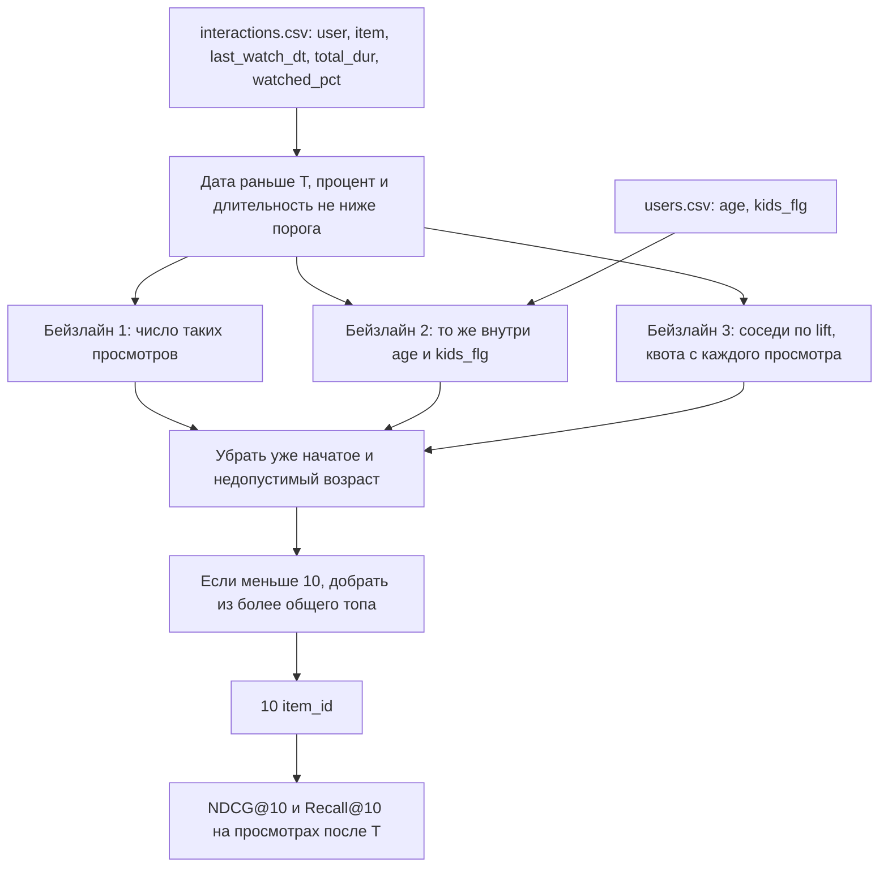
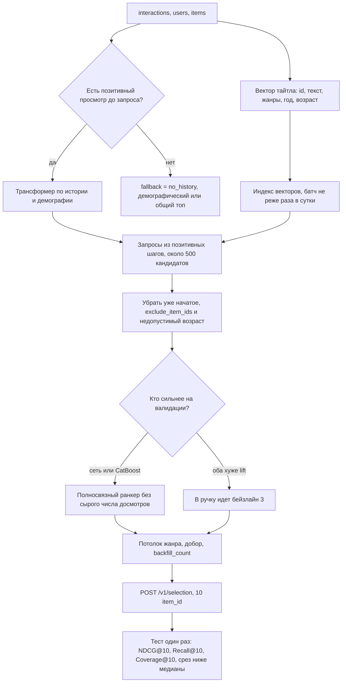

# Дизайн ML системы — подборка «Вам понравится»

| | |
| --- | --- |
| Продукт | Подборка «Вам понравится» на главной онлайн-кинотеатра, 10 тайтлов |
| Итерация | Офлайн-сравнение с популярностью на публичном срезе KION |
| Статус | Постановка. EDA, обучение и API еще не делались |

Своего трафика нет, поэтому пилот считаем на публичной выборке просмотров [KION](https://github.com/irsafilo/KION_DATASET). В ней взаимодействие записано в момент просмотра, рядом лежат длительность и процент досмотра, и подборка оптимизирует включение и досмотр.

## 1. Цели и предпосылки

### 1.1. Зачем идем в разработку продукта?

На главной кинотеатра несколько подборок. Часть собирает редакция, часть строится простыми правилами вроде «сейчас это смотрят все». Подборка «Вам понравится» нужна затем, чтобы человек уходил в просмотр прямо с главной и не начинал поиск по названию. Для подписки важно, что фильм или сериал включили и не бросили в начале.

Общий топ по числу досмотров один на всех: он не убирает уже начатое и не смотрит остальную историю. Редакция не соберет отдельную десятку на каждого. История просмотров для этого есть. По ней можно выделить несколько интересов и к каждому подобрать похожие тайтлы, а уже короткий список разложить ранкером. Полный перебор каталога тяжелым ранкером на каждый запрос не нужен.

Итерация заканчивается офлайн-сравнением, а не выкладкой в KION. На отложенном по времени хвосте персональный список должен быть выше глобальной популярности по NDCG@10 и Recall@10. Релевантен тайтл, у которого и процент досмотра, и длительность не ниже своих порогов. Стартовая цифра прироста — плюс 10% NDCG@10 к популярности, ее запираем на валидации до теста. На этом же срезе опубликованный бейзлайн популярности дает MAP@10 около 0.091, а градиентный бустинг на конкурсе KION был около 0.114, так что заметный, но не огромный отрыв от топа здесь уже видели.

Рядом посчитаем второй ориентир: популярное внутри той же возрастной группы и того же признака «есть дети». Средняя история в срезе — около шести тайтлов, жанровый профиль часто пустой, и демографический топ для таких пользователей честнее, чем «популярное в любимых жанрах». Если обойдем только общий топ и не обойдем демографический, так и напишем. Третий ориентир — соседи по совместным досмотрам с поправкой на популярность. Он уже не схлопывается в общий топ формулой счета, и более сложная модель имеет смысл, только если обходит его на валидации. В десятке не должно быть уже начатых тайтлов, а при пустой истории или недоступной модели главная получает популярное, а не ошибку. Выручку и удержание подписки по этому срезу не считаем.

### 1.2. Бизнес-требования и ограничения

Подборка всегда состоит из 10 позиций и может содержать и фильмы, и сериалы: на главной кинотеатра они стоят вместе, а в данных они различаются полем `content_type`. Короче десятка бывает только тогда, когда после фильтров в каталоге не осталось десяти позиций. Тайтл, который пользователь уже смотрел до момента запроса, в список не попадает, потому что «продолжить просмотр» — отдельная подборка. Кинотеатр может дополнительно передать свои исключения: нет прав, тайтл не входит в подписку или уже стоит на соседней подборке.

Если у пользователя нет просмотров до запроса, но есть возрастная группа или `kids_flg`, отдаем популярное в этой группе и ставим `fallback = no_history`. Если нет ни истории, ни пригодной демографии, либо модель недоступна, отдаем глобальный топ с `fallback = model_unavailable` или `no_history` соответственно. При тех же файлах модели и том же запросе список должен совпадать от запуска к запуску, ничья по скору режется меньшим `item_id`. Популярность и остальные признаки считаются только по просмотрам до момента запроса.

Векторы тайтлов и индекс пересчитываются батчем, не реже раза в сутки. Новый тайтл попадает в индекс со следующей сборки по тексту и полям каталога, даже если его еще никто не досмотрел. Идентификатор набирает вес по мере просмотров. Вектор пользователя считается в момент запроса по уже известной истории, поэтому новый досмотр меняет подборку раньше полного переобучения. Пока расписания нет, батч запускают вручную, и рядом с артефактом записано, на какой дате он обучен. Повторить счет можно по README: ссылка на выгрузку, команды и отсечка. Цифры снимаем скриптом.

Если `kids_flg` говорит, что подборкой пользуется ребенок, кандидатов режем по `age_rating` и `for_kids`. Точную границу рейтинга выберем после EDA, когда увидим шкалу и сколько таких пользователей. При сборке десятки ни один жанр не занимает больше пяти позиций, пока ниже по списку есть тайтл без этого жанра. Тайтл с несколькими жанрами считается в каждом из них. Долю добора из популярного пишем в ответ и в отчет. Права и подписку модель по-прежнему не хранит: их присылают в `exclude_item_ids`.

Обучение ретривера, текстовой проекции и ранкера идет на GPU. На запрос считаются вектор пользователя, поиск по индексу и ранкер. Каталог пилота, 15 706 позиций, допускает точный поиск. Интерфейс индекса тот же, что у приближенного: когда каталог вырастет, меняется поиск, а не остальной путь. Когда появится API, ориентир по задержке — p95 меньше 100 мс на одном инстансе, без учета сети клиента. Сейчас это не измерено и в успех итерации не входит.

Главная на пилоте ходит в `POST /v1/selection`.

```json
{
  "user_id": 42,
  "k": 10,
  "exclude_item_ids": [1, 2]
}
```

```json
{
  "user_id": 42,
  "fallback": "none",
  "backfill_count": 0,
  "items": [
    {"item_id": 10711, "position": 1, "score": 0.91}
  ]
}
```

Поле `score` нужно для разбора, на главной показывается только порядок. `k` в этой итерации всегда 10. `backfill_count` — сколько позиций добрали популярным. Когда подборку реально показывают, ручка пишет `user_id`, порядок `item_id`, версию модели и время. На публичном срезе таких строк нет, поэтому поправку на показ в этой итерации не учим. Формат лога нужен, чтобы следующая модель его уже застала.

Срез — анонимная выборка KION с добавленным шумом, а не полный лог продакшена, поэтому прирост на всех подписчиках из нее не следует. Публичная часть покрывает 13 марта 2021 — 22 августа 2022: 5 476 251 взаимодействие, 962 179 пользователей и 15 706 тайтлов. Неделя сразу после этого периода лежит в закрытой части, ее можно попробовать прогнать через [песочницу конкурса](https://ods.ai/competitions/competition-recsys-21/leaderboard/public_sandbox), но успех итерации на ней не держим: песочница может не принять решение. В репозиторий архив не кладем.

Короткий старт и досмотр до конца различаются полями `watched_pct` и `total_dur`, границу для метрики выбираем мы по обоим. Доход, пол и возраст записаны группами и бывают пустыми. Устройство и регион прав в файле отсутствуют. Показов подборки в файле нет, и офлайн-метрика благосклонна к тайтлам, которые людям и так показывали.

К концу итерации нужен офлайн-отчет, где бейзлайны и выбранный контур посчитаны на одной дате отсечки, и ручка, которая не показывает уже начатое, умеет фолбэк, пишет `backfill_count` и повторяется. Сначала считаем списки для пользователей тестового хвоста и смотрим, попали ли туда тайтлы, которые они потом досмотрели не ниже обоих порогов. Если порог пройден, поднимаем API и сверяем ответ со списком из отчета на тех же `user_id`. Живого A/B нет. CTR подборки и минуты в плеере остаются метриками кинотеатра, под которые выбран досмотр.

На валидации сравниваем списочную сеть и CatBoost на одних и тех же кандидатах ретривера. Победитель идет дальше. Если оба проигрывают списку соседей по lift, в тест и в ручку идет lift, и в отчете так и написано. Пилот считаем успешным по тому контуру, который зафиксировали до открытия теста: он выше глобальной популярности по NDCG@10 и Recall@10, отрыв есть и на позитивах ниже медианы популярности каталога, уже начатые отфильтрованы, детский рейтинг соблюден там, где `kids_flg` заполнен, фолбэк работает и повторный запрос дает тот же список. Стартовая гипотеза порога — плюс 10% NDCG@10 к популярности. Рост относительно демографического топа пишем отдельно. Если Coverage@10 упал больше чем вдвое относительно глобального топа, модель не принимаем: десятки стали слишком похожими. Если у самого топа покрытие и так маленькое, этот порог поправим после EDA.

### 1.3. Что входит в скоуп проекта/итерации, что не входит

В итерации одна подборка на 10 тайтлов. Позитив — просмотр выше порогов по `watched_pct` и `total_dur`. Три бейзлайна: общий счетчик таких просмотров, тот же счетчик внутри возрастной группы и `kids_flg`, соседи по lift. Модель — двухбашенный ретривер, списочный ранкер и CatBoost на тех же полях. Сюда же входят временное разбиение, фильтры, потолок жанра, добор, офлайн-отчет, `POST /v1/selection` и лог показов. Обучение на GPU, индекс векторов входит в итерацию. Устройство модели и метрик — в разделе 2.

Текстовый поиск, диалог, разбор постеров и субтитров не делаем. Подборки «продолжить просмотр», «похожее» и «новинки» тоже не делаем. Онлайн-дообучение, бандиты, боевой A/B и поправку на показ по чужим логам не учим: в публичном срезе показов нет. Feature store и Kubernetes остаются за скоупом. Права и состав подписки определяет кинотеатр.

Код уже проверяется Ruff и pre-commit, версии зависимостей лежат в `pyproject.toml`. Метрики итерации снимаем скриптом. В отчете будут ссылка на выгрузку `data_original.zip`, хеш файла, который посчитаем при скачивании, даты отсечек и какая модель победила на валидации. Строки случайно не перемешиваем. Векторы тайтлов считаются батчем. Потока новых просмотров в файле нет: на пилоте история читается из среза по `user_id`, в теле запроса ее нет.

### 1.4. Предпосылки решения

Оптимизируем состав и порядок десяти тайтлов в момент запроса. В опубликованном файле одна строка — это пара «пользователь, тайтл», а не каждый заход в плеер: дата записана как `last_watch_dt`, рядом лежат суммарная длительность `total_dur` и процент `watched_pct`. Повторные сессии по отдельности не восстановить. На запросе объект — список для одного `user_id`.

Горизонт — осмысленные просмотры после даты T. В тесте релевантен тайтл с `last_watch_dt` не раньше T, процентом и длительностью не ниже порогов и без просмотра до T. Стартовая гипотеза процента — 50%. Порог минут запишем после гистограммы `total_dur`. На распределениях проверим, не сидит ли почти вся масса процентов у нуля и у ста и не слишком ли много коротких стартов длинных фильмов. После открытия теста границы не двигаем. В ретривер идут только такие позитивы. Просмотры ниже любого из порогов ранкер может видеть как негативы, если по EDA их достаточно.

Уже начатым для фильтра подборки считаем любое взаимодействие до T с `watched_pct` больше нуля. Если выяснится, что много строк — это случайный старт на пару процентов, границу «уже смотрел» поднимем до теста отдельно от границы релевантности.

| Данные | Файл | Поля | Зачем | Уже смотрели |
| --- | --- | --- | --- | --- |
| Просмотры | `interactions.csv` | `user_id`, `item_id`, `last_watch_dt`, `total_dur`, `watched_pct` | История, позитив, отсечка | Нет |
| Пользователи | `users.csv` | `user_id`, `age`, `income`, `sex`, `kids_flg` | Токен пользователя, демографический бейзлайн, детский фильтр | Нет |
| Каталог | `items.csv` | `item_id`, `content_type`, `title`, `title_orig`, `release_year`, жанры, страны, `for_kids`, `age_rating`, студии, режиссеры, актеры, описание, ключевые слова | Вектор тайтла и правила сборки | Нет |

Берем русскую выгрузку [data_original.zip](https://github.com/irsafilo/KION_DATASET/raw/f69775be31fa5779907cf0a92ddedb70037fb5ae/data_original.zip). Готовых md5 в описании нет, хеш архива запишем при скачивании. Английский перевод метаданных не используем: названия и описания нам нужны в исходном виде. Текстовый энкодер на старте — замороженный [multilingual-e5](https://arxiv.org/abs/2402.05672). Учим проекцию поверх него. Если на валидации дообучение энкодера поднимет Recall ретривера, разрешим его до теста и запишем, какой слой разморозили.

Дата в файле дневная, часа просмотра нет, поэтому время суток в признаки не кладем. Возраст, пол и доход — группы, не точные числа. Пол и доход в демографический топ не входят: группы часто пустые, и список внутри них быстро кончается. В токене пользователя они остаются. Если возраст или `kids_flg` пустые, пользователь для демографического топа не годится и проваливается в глобальную популярность.

Холодный по истории — тот, у кого до T нет ни одного просмотра. Таких будет много: средняя длина истории около 5.7. Им показываем популярное в их возрастной группе и `kids_flg`, если эти поля заполнены. Без единого просмотра отдельный вектор пользователя из одной только демографии повторил бы тот же топ, поэтому башню для них не вызываем. Холодный тайтл — без досмотров до T. Он остается в индексе за счет текста и полей каталога. Долю тестовых позитивов без истории до T и долю позитивов по холодным тайтлам напишем рядом с NDCG.

Популярность, lift, текстовые векторы и веса сети считаем по данным строго до T. Гиперпараметры выбираем на более раннем окне, тестовый хвост открываем один раз.

## 2. Методология

### 2.1. Постановка задачи

Технически это сборка top-10 по неявным просмотрам. На вход приходят `user_id`, его просмотры до даты запроса, демография, если она есть, и каталог. На выход — десять `item_id`. В тесте тайтл релевантен, если после T пользователь посмотрел его не ниже обоих порогов.

В среднее NDCG берем тех, у кого есть хотя бы один позитив до T и хотя бы один после. Без истории идут в фолбэк и в среднее ранкера не входят. Без позитива в тесте тоже не входят. Долю исключенных напишем рядом.

Бейзлайн, с которым сравниваем успех:

`score(item) = число просмотров с обоими порогами и last_watch_dt < T`

Список общий. Для каждого пользователя из него вычеркивается уже начатое, остаются первые десять, ничья режется меньшим `item_id`. Второй бейзлайн считает тот же счетчик только по пользователям с той же возрастной группой и тем же `kids_flg`. Если группа пустая или после фильтра осталось меньше десяти тайтлов, добираем из общего топа. Пол и доход в эти счетчики не входят.

Третий бейзлайн считает lift по позитивам до T: совместные досмотры пары делятся на произведение популярностей обоих тайтлов. Пары с редким пересечением отсекаем, порог числа совместных позитивов запираем до теста. С каждого позитивного просмотра пользователя берем квоту соседей, квоты объединяем и сортируем по лучшему lift. Стартовая квота — 20 соседей. Уже начатое убираем, при нехватке добираем из демографического топа, затем из общего. Квоту подбираем на валидации.

Ретривер — двухбашенная модель. Вектор тайтла складывается из выученного идентификатора, проекции замороженного текстового энкодера и полей каталога: тип, жанры, страны, студии, год, возрастной рейтинг, `for_kids`. В текст идут название, оригинальное название, описание, ключевые слова, актеры и режиссеры. Вектор пользователя — трансформер по истории [Kang, McAuley, 2018](https://doi.org/10.1109/ICDM.2018.00035). В последовательность входят все просмотры до запроса, не только позитивы: на шаге лежат вектор тайтла, давность, `watched_pct` и `total_dur`, плюс отдельный токен с возрастом, полом, доходом и `kids_flg`. Запросы в индекс идут из состояний позитивных шагов, чтобы случайный старт не набирал соседей. Внимание по короткой истории нужно потому, что с одного аккаунта часто смотрят разное, и одно среднее по всем просмотрам тянет список к общему вкусу.

Учится ретривер контрастно. Негативы берутся пропорционально популярности, на выходе из скалярного произведения вычитается логарифм популярности тайтла, как в поправке на смещение выборки [Yi et al., 2019](https://doi.org/10.1145/3298689.3346996). Популярный тайтл остается в выдаче, когда он близок к истории, и перестает быть самым легким ответом для всех. Индекс опрашивается из состояний трансформера по истории. С каждого состояния берется квота, чтобы один громкий просмотр не забил пул. Стартовая ширина пула — около 500 кандидатов. Число состояний и ширину подбираем на валидации по Recall@500: старт — состояние на каждый позитив, но не больше десяти. Если будущих позитивов нет уже среди пятисот, сначала расширяем пул и проверяем текстовую проекцию, потом трогаем ранкер.

Ранкер — небольшая полносвязная сеть. Лосс списочный: внутри пользователя позитивы окна против остальных кандидатов пула. Сеть видит скор ретривера, близость к истории, пересечение жанров, совпадение `content_type`, возраст и `kids_flg`, год выпуска. Сырое число досмотров тайтла в признаки не входит: популярность уже вычтена в скоре ретривера. Контроль — CatBoost с лоссом YetiRank, группа равна пользователю, поля те же, отсечка та же. На валидации остается один из двух.

Обучение режем по `last_watch_dt`. Стартовая схема, ее поправим, когда увидим, сколько позитивов приходится на хвост: последние 14 дней публичного периода — тест, предыдущие 14 дней — окно ранкера, все более ранние даты учат башни. Горизонт в две недели близок к неделе, на которой считали конкурсный MAP@10, и при этом оставляет ранкеру отдельное окно. Если в этих двух неделях слишком мало досмотров, окно расширим до теста и запишем даты.

Перед отчетом выбранный контур учим заново на всей истории до начала теста с уже выбранными параметрами и один раз считаем тест. На тесте из пула сначала убираем уже начатое, внешние исключения и недопустимый возраст, затем сортируем. При наборе десятки действует жанровый потолок из раздела 1.2. Недостающее добираем из демографического топа, а если группа пустая — из общего, и пишем `backfill_count`.

| Что хотим от подборки | Что есть в KION | Что считаем |
| --- | --- | --- |
| Человек включил тайтл и досмотрел осмысленно | `watched_pct`, `total_dur`, без показов подборки | Recall@10 и NDCG@10 по обоим порогам |
| Списки не схлопнулись в один топ | Считается по выдачам | Coverage@10 |
| Прирост не только на хитах | Популярность тайтла до T | NDCG@10 на тайтлах ниже медианы |
| Ретривер не выкинул нужное | Считается по пулу | Recall@500 |
| Сеть обходит простой список соседей | Lift по совместным досмотрам | NDCG@10 против бейзлайна 3, выбор до теста |
| Сравнение с опубликованным бейзлайном конкурса | Любой просмотр на хвосте, не только досмотр | MAP@10 рядом, не в пороге приемки |

MAP@10 по любому последующему просмотру оставляем справочной цифрой: у конкурса популярность давала около 0.091, но в приемку итерации входит осмысленный досмотр, а не любой старт. Coverage@10 — доля каталога, которая попала хотя бы в одну десятку на тесте. В срезе ниже медианы релевантны только позитивы, у которых число досмотров до T ниже медианы каталога. Пользователи без таких позитивов в это среднее не входят, список при этом тот же.

### 2.2. Блок-схема решения

Схемы две. У первых двух бейзлайнов скор тайтла — это счетчик досмотров. Третий собирает соседей по lift. У MVP скор зависит от истории через башни и ранкер, а счетчик остается запасным списком.

#### Бейзлайны



Читаем просмотры и пользователей. Для счета оставляем даты строго раньше T и оба порога. Бейзлайн 1 считает это по всему срезу, бейзлайн 2 — внутри возрастной группы и `kids_flg`, бейзлайн 3 — соседей по lift. Если после фильтра осталось меньше десяти, второй добирает из общего топа, третий — сначала из демографического, потом из общего. Первый из общего топа и состоит. Метрики на хвосте те же, что у MVP.

#### MVP



Если позитивного просмотра до запроса нет, башню не вызываем. Иначе обучение режется на три последовательных куска по `last_watch_dt`, и все, что не раньше T, в обучении не участвует. На запросе из пула сначала убирают уже начатое, исключения и недопустимый возраст. Дальше остается ранкер, выигравший валидацию, либо бейзлайн 3, если ранкер ему проиграл. Тест прогоняем один раз.

### Что уточним по данным, прежде чем запирать параметры

Размеры выборок, фактические даты двухнедельных окон, порог минут, ширина пула, квота lift и число состояний истории появятся после EDA. До этого рано фиксировать 50%, 20 соседей и 500 кандидатов. Нужно посмотреть распределение `watched_pct` и `total_dur`, сколько позитивов попадает в последние 14 и 28 дней, какая доля пользователей на отсечке остается без истории, как часто пустые `age`, `income`, `sex` и `kids_flg`, какие значения принимает `age_rating`, сколько жанров у типичного тайтла, с какого числа совместных просмотров lift стабилен, есть ли повторные пары `user_id, item_id`, какая доля тайтлов приходится на сериалы, насколько заполнены описание, актеры и режиссеры и насколько будущий досмотр и так виден по глобальной популярности.

## Источники

- Safilo, I. MTS Kion Implicit Contextualised Sequential Dataset for Movie Recommendation, репозиторий данных: [KION_DATASET](https://github.com/irsafilo/KION_DATASET), русская выгрузка [data_original.zip](https://github.com/irsafilo/KION_DATASET/raw/f69775be31fa5779907cf0a92ddedb70037fb5ae/data_original.zip).
- Petrov, A., Safilo, I., Tikhonovich, D., Ignatov, D. MTS Kion Implicit Contextualised Sequential Dataset for Movie Recommendation. RecSys CARS Workshop, 2022. [arXiv:2209.00325](https://arxiv.org/abs/2209.00325).
- Kang, W.-C., McAuley, J. Self-Attentive Sequential Recommendation. IEEE ICDM, 2018. [doi:10.1109/ICDM.2018.00035](https://doi.org/10.1109/ICDM.2018.00035).
- Yi, X., Yang, J., Hong, L., Cheng, D. Z., Heldt, L., Kumthekar, A., Zhao, Z., Wei, L., Chi, E. Sampling-Bias-Corrected Neural Modeling for Large Corpus Item Recommendations. ACM RecSys, 2019. [doi:10.1145/3298689.3346996](https://doi.org/10.1145/3298689.3346996).
- Wang, L., Yang, N., Huang, X., Yang, L., Majumder, R., Wei, F. Multilingual E5 Text Embeddings: A Technical Report. 2024. [arXiv:2402.05672](https://arxiv.org/abs/2402.05672).
