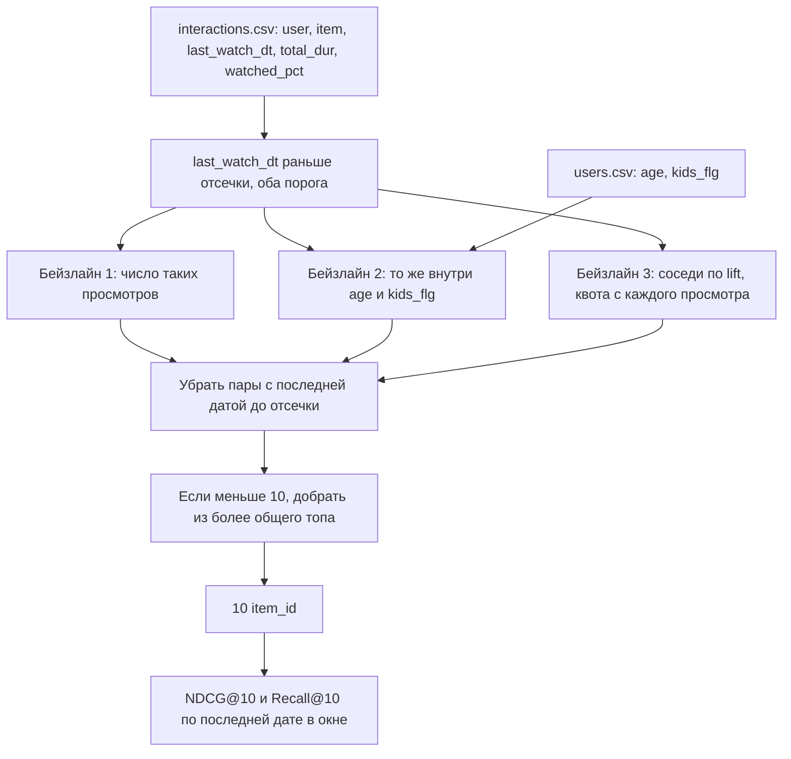
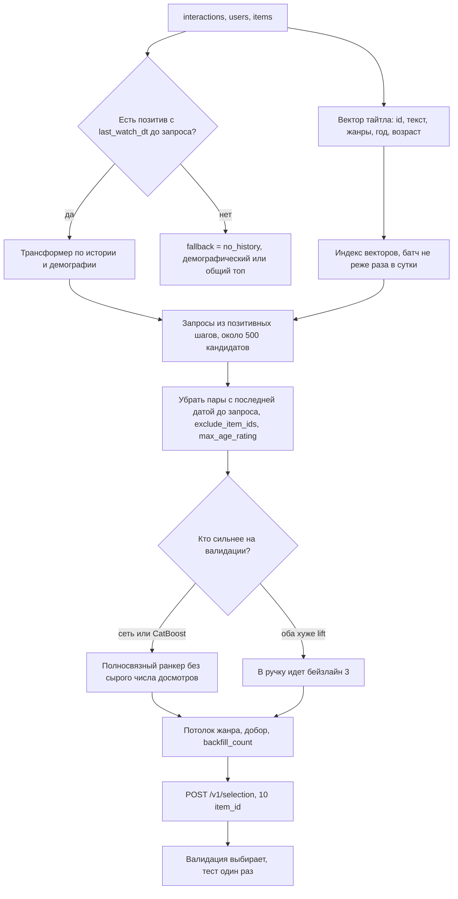

# Дизайн ML системы — подборка «Вам понравится»

| | |
| --- | --- |
| Продукт | Подборка «Вам понравится» на главной онлайн-кинотеатра, 10 тайтлов |
| Итерация | Офлайн-сравнение с популярностью на публичном срезе KION |
| Статус | Постановка и EDA. Обучение и API еще не делались. Разбор среза — в [отчете](../reports/eda.md) |

Своего трафика нет, поэтому пилот считаем на публичной выборке просмотров [KION](https://github.com/irsafilo/KION_DATASET). В ней взаимодействие записано в момент просмотра, рядом лежат длительность и процент досмотра, и подборка оптимизирует включение и досмотр.

## 1. Цели и предпосылки

### 1.1. Зачем идем в разработку продукта?

На главной кинотеатра несколько подборок. Часть собирает редакция, часть строится простыми правилами вроде «сейчас это смотрят все». Подборка «Вам понравится» нужна затем, чтобы человек уходил в просмотр прямо с главной и не начинал поиск по названию. Для подписки важно, что фильм или сериал включили и не бросили в начале.

Общий топ по числу досмотров один на всех: он не убирает уже начатое и не смотрит остальную историю. Редакция не соберет отдельную десятку на каждого. История просмотров для этого есть. По ней можно выделить несколько интересов и к каждому подобрать похожие тайтлы, а уже короткий список разложить ранкером. Полный перебор каталога тяжелым ранкером на каждый запрос не нужен.

Итерация заканчивается офлайн-сравнением, а не выкладкой в KION. На отложенном по времени хвосте персональный список должен быть выше глобальной популярности по NDCG@10 и Recall@10. Релевантен тайтл, у которого и процент досмотра, и длительность не ниже своих порогов. Стартовая цифра прироста — плюс 10% NDCG@10 к популярности. На закрытой неделе конкурса популярность давала MAP@10 около 0.091, градиентный бустинг — около 0.114. На этом файле, если релевантным считать любой просмотр, тот же счетчик дает MAP@10 0.077 за последние 7 дней и 0.082 за последние 14. Отрыв от топа в несколько сотых на этом файле уже получается. Песочницу конкурса этими двумя числами не повторить.

Рядом посчитаем второй ориентир: популярное внутри той же возрастной группы и того же признака «есть дети». Средняя история — 5.69 тайтла, медиана — 2, у 36.9% пользователей одна строка. Жанровый профиль у такой истории часто пустой, и демографический топ для холодного пользователя честнее, чем «популярное в любимых жанрах». На тестовом окне демографический топ дал NDCG@10 0.136, общий — 0.137. В приемку по-прежнему идет отрыв от общего топа, демографический пишем рядом. Третий ориентир — соседи по совместным досмотрам с поправкой на популярность. Он уже не схлопывается в общий топ формулой счета, и более сложная модель имеет смысл, только если обходит его на валидации. В десятке не должно быть тайтлов, которые к моменту запроса уже лежат в журнале просмотров. На этом срезе журнал пары — одна последняя дата, поэтому офлайн видит только те, что целиком раньше отсечки. При пустой истории или недоступной модели главная получает популярное, а не ошибку. Выручку и удержание подписки по этому срезу не считаем.

### 1.2. Бизнес-требования и ограничения

Подборка всегда состоит из 10 позиций и может содержать и фильмы, и сериалы: на главной кинотеатра они стоят вместе, а в данных они различаются полем `content_type`. Короче десятка бывает только тогда, когда после фильтров в каталоге не осталось десяти позиций. Тайтл, который к моменту запроса уже есть в журнале просмотров, в список не попадает, потому что «продолжить просмотр» — отдельная подборка. В публичном срезе у пары хранится только `last_watch_dt`, поэтому офлайн убирает пары, у которых эта дата раньше отсечки, и не видит начало, если последняя дата позже. Кинотеатр может дополнительно передать свои исключения: нет прав, тайтл не входит в подписку или уже стоит на соседней подборке.

Если нет позитива с `last_watch_dt` раньше запроса, башню не вызываем. Сюда входит и пустая история, и история, где прошлые строки есть, но порог позитива не пройден. Когда заполнены и возраст, и `kids_flg`, отдаем популярное в этой группе, иначе общий топ, и ставим `fallback = no_history`. Если модель недоступна, отдаем глобальный топ с `fallback = model_unavailable`. При тех же файлах модели и том же запросе список должен совпадать от запуска к запуску, ничья по скору режется меньшим `item_id`. Популярность и остальные признаки считаются только по строкам с `last_watch_dt` раньше запроса.

Векторы тайтлов и индекс пересчитываются батчем, не реже раза в сутки. Новый тайтл попадает в индекс со следующей сборки по тексту и полям каталога, даже если его еще никто не досмотрел. Идентификатор набирает вес по мере просмотров. Вектор пользователя считается в момент запроса по уже известной истории, поэтому новый досмотр меняет подборку раньше полного переобучения. Пока расписания нет, батч запускают вручную, и рядом с артефактом записано, на какой дате он обучен. Повторить счет можно по README: ссылка на выгрузку, команды и отсечка. Цифры снимаем скриптом.

`kids_flg` в русской выгрузке — флаг анкеты «у пользователя есть дети». В части описаний то же поле называют has_kids. Оно не говорит, кто сидит перед экраном: в такой семье взрослый смотрит и взрослые тайтлы. По этому флагу каталог не режем. Возрастной потолок приходит в запросе отдельным полем, когда кинотеатр знает, что сеанс детский. На публичном срезе такого поля нет, поэтому в офлайне `age_rating` и `for_kids` остаются признаками модели, а не правилом отсечения. При сборке десятки ни один жанр не занимает больше пяти позиций, пока ниже по списку есть тайтл без этого жанра. Тайтл с несколькими жанрами считается в каждом из них. Долю добора из популярного пишем в ответ и в отчет. Права и подписку модель по-прежнему не хранит: их присылают в `exclude_item_ids`.

Обучение ретривера, текстовой проекции и ранкера идет на GPU. На запрос считаются вектор пользователя, поиск по индексу и ранкер. Каталог пилота, 15 706 позиций, допускает точный поиск. Интерфейс индекса тот же, что у приближенного: когда каталог вырастет, меняется поиск, а не остальной путь. Когда появится API, ориентир по задержке — p95 меньше 100 мс на одном инстансе, без учета сети клиента. Сейчас это не измерено и в успех итерации не входит.

Главная на пилоте ходит в `POST /v1/selection`.

```json
{
  "user_id": 42,
  "k": 10,
  "exclude_item_ids": [1, 2],
  "max_age_rating": null
}
```

```json
{
  "user_id": 42,
  "fallback": "none",
  "backfill_count": 0,
  "items": [
    {"item_id": 10711, "position": 1, "score": 0.91}
  ]
}
```

Поле `score` нужно для разбора, на главной показывается только порядок. `k` в этой итерации всегда 10. `max_age_rating` пустой, если сеанс не детский: из `kids_flg` его не выводим. `backfill_count` — сколько позиций добрали популярным. Когда подборку реально показывают, ручка пишет `user_id`, порядок `item_id`, версию модели и время. На публичном срезе таких строк нет, поэтому поправку на показ в этой итерации не учим. Формат лога нужен, чтобы следующая модель его уже застала.

Срез — анонимная выборка KION с добавленным шумом, а не полный лог продакшена, поэтому прирост на всех подписчиках из нее не следует. В файле 5 476 251 взаимодействие, 962 179 пользователей и 15 706 тайтлов. Даты с 13 марта по 22 августа 2021, 163 дня, пропусков нет. В README датасета конец периода указан как 22 августа 2022. Счетчики строк совпадают с описанием, в csv последняя дата 2021-08-22, ее и берем. Неделя сразу после последней даты файла лежит в закрытой части, ее можно попробовать прогнать через [песочницу конкурса](https://ods.ai/competitions/competition-recsys-21/leaderboard/public_sandbox), но успех итерации на ней не держим: песочница может не принять решение. В репозиторий архив не кладем.

Короткий старт и досмотр до конца различаются полями `watched_pct` и `total_dur`, границу для метрики выбираем мы по обоим. Доход, пол и возраст записаны группами и бывают пустыми. Устройство и регион прав в файле отсутствуют. Показов подборки в файле нет, и офлайн-метрика благосклонна к тайтлам, которые людям и так показывали.

К концу итерации нужен офлайн-отчет, где бейзлайны и выбранный контур посчитаны на одной дате отсечки, и ручка, которая убирает пары с последней датой до запроса, умеет фолбэк, пишет `backfill_count` и повторяется. Сначала считаем списки для пользователей тестового хвоста и смотрим, попали ли туда тайтлы, чье последнее касание в тестовом окне дотягивает до обоих порогов. Если порог пройден, поднимаем API и сверяем ответ со списком из отчета на тех же `user_id`. Живого A/B нет. CTR подборки и минуты в плеере остаются метриками кинотеатра, под которые выбран досмотр.

На валидации сравниваем списочную сеть и CatBoost на одних и тех же кандидатах ретривера. Победитель идет дальше. Если оба проигрывают списку соседей по lift, в тест и в ручку идет lift, и в отчете так и написано. Пилот считаем успешным по тому контуру, который зафиксировали до обучения на тесте: он выше глобальной популярности по NDCG@10 и Recall@10, на позитивах вне топ-100 до отсечки он выше списка соседей по lift, пары с последней датой до отсечки убраны, переданный `max_age_rating` соблюден, фолбэк работает и повторный запрос дает тот же список. Порог к популярности — плюс 10% NDCG@10. Рост относительно демографического топа пишем отдельно: на этом файле он не выше общего, в приемку его не ставим. Coverage@10 глобального топа на тесте — 31 тайтл из 15 963, демографического — 46. Половина от 31 — это 16 тайтлов, так что порог «не упасть вдвое относительно глобального топа» здесь слабый. Модель не принимаем, если Coverage@10 ниже 320 тайтлов, это 2% каталога.

### 1.3. Что входит в скоуп проекта/итерации, что не входит

В итерации одна подборка на 10 тайтлов. Позитив — просмотр выше порогов по `watched_pct` и `total_dur`. Три бейзлайна: общий счетчик таких просмотров, тот же счетчик внутри возрастной группы и `kids_flg`, соседи по lift. Модель — двухбашенный ретривер, списочный ранкер и CatBoost на тех же полях. Сюда же входят временное разбиение, фильтры, потолок жанра, добор, офлайн-отчет, `POST /v1/selection` и лог показов. Обучение на GPU, индекс векторов входит в итерацию. Устройство модели и метрик — в разделе 2.

Текстовый поиск, диалог, разбор постеров и субтитров не делаем. Подборки «продолжить просмотр», «похожее» и «новинки» тоже не делаем. Онлайн-дообучение, бандиты, боевой A/B и поправку на показ по чужим логам не учим: в публичном срезе показов нет. Feature store и Kubernetes остаются за скоупом. Права и состав подписки определяет кинотеатр.

Код уже проверяется Ruff и pre-commit, версии зависимостей лежат в `pyproject.toml`. Метрики итерации снимаем скриптом. В отчете — ссылка на выгрузку `data_original.zip`, хеш архива, даты отсечек и какая модель победила на валидации. Хеш уже посчитан: sha256 `50fc5b7db78cbda4c3d0ee5bb5bea4c416cff41e8af58aab0b661d0d3e9dfa9b`, md5 `87ec2729ca79a866f0d5b6bd2e94e5fa`. Строки случайно не перемешиваем. Векторы тайтлов считаются батчем. Потока новых просмотров в файле нет: на пилоте история читается из среза по `user_id`, в теле запроса ее нет.

### 1.4. Предпосылки решения

Оптимизируем состав и порядок десяти тайтлов в момент запроса. В опубликованном файле одна строка — это пара «пользователь, тайтл», а не каждый заход в плеер: дата записана как `last_watch_dt`, и это последний просмотр пары, не первый. Рядом лежат суммарные `total_dur` и `watched_pct` за все время. Повторные сессии и дату начала по этой строке не восстановить. На запросе объект — список для одного `user_id`.

Если `last_watch_dt` раньше отсечки, вся известная история пары лежит до нее: более позднего просмотра в файле нет. Если дата на отсечке или позже, строка могла начаться раньше. Длительность и процент за весь срок, разрезать их на «до» и «после» нельзя. Такую строку не считаем доказательством, что до отсечки просмотра не было. В историю до отсечки ее не кладем: часть просмотра могла быть позже. В метрике это позитив окна, куда попала последняя дата, с явной оговоркой: мы видим последнее касание, а не новый старт.

Позитив — строка, у которой `watched_pct` не ниже 50 и `total_dur` не ниже 10 минут. На гистограмме процента пики в нуле и в ста, между ними тоже есть масса. Десять минут убирают 25 899 строк с процентом от 50. У остальных таких строк десятый перцентиль длительности — 66 минут. После EDA границы не двигаем, на валидации тоже. В обучение башен идут только позитивы с последней датой внутри обучающего куска. Просмотров ниже любого из порогов больше половины файла, ранкеру негативов хватает.

Уже начатой для фильтра считаем пару, у которой `last_watch_dt` раньше момента запроса и `watched_pct` больше нуля. Точный ноль — 13.3% строк. В позитив они не входят. Для фильтра «уже смотрел» пара с процентом больше нуля уже лежит в журнале. Пару, чья последняя дата позже запроса, фильтр не видит, даже если смотреть ее начали раньше. В живом журнале кинотеатра начало сессии известно, и там фильтр полный. На этом срезе он покрывает только пары, целиком лежащие до отсечки. Повторов пары `user_id, item_id` в файле нет.

| Данные | Файл | Поля | Зачем | Уже смотрели |
| --- | --- | --- | --- | --- |
| Просмотры | `interactions.csv` | `user_id`, `item_id`, `last_watch_dt`, `total_dur`, `watched_pct` | История, позитив, отсечка | Да |
| Пользователи | `users.csv` | `user_id`, `age`, `income`, `sex`, `kids_flg` | Токен пользователя и демографический бейзлайн. `kids_flg` значит «есть дети», не «сейчас смотрит ребенок» | Да |
| Каталог | `items.csv` | `item_id`, `content_type`, `title`, `title_orig`, `release_year`, жанры, страны, `for_kids`, `age_rating`, студии, режиссеры, актеры, описание, ключевые слова | Вектор тайтла и правила сборки | Да |

Берем русскую выгрузку [data_original.zip](https://github.com/irsafilo/KION_DATASET/raw/f69775be31fa5779907cf0a92ddedb70037fb5ae/data_original.zip). sha256 архива `50fc5b7db78cbda4c3d0ee5bb5bea4c416cff41e8af58aab0b661d0d3e9dfa9b`, md5 `87ec2729ca79a866f0d5b6bd2e94e5fa`. Английский перевод метаданных не используем: названия и описания нам нужны в исходном виде. Текстовый энкодер на старте — замороженный [multilingual-e5](https://arxiv.org/abs/2402.05672). Учим проекцию поверх него. Если на валидации дообучение энкодера поднимет Recall ретривера, разрешим его до теста и запишем, какой слой разморозили.

Дата в файле дневная, часа просмотра нет, поэтому время суток в признаки не кладем. Возраст, пол и доход — группы, не точные числа. Пол и доход в демографический топ не входят. Внутри `users.csv` пустых значений около 1.7%, но пересечение возраста, `kids_flg`, пола и дохода дает 143 группы, минимум — один пользователь. Возраст и `kids_flg` дают 12 групп, в меньшей из них 4 110 пользователей взаимодействий, и десятка там не кончается. В токене пользователя пол и доход остаются. Если возраст или `kids_flg` пустые, пользователь для демографического топа не годится и проваливается в глобальную популярность.

Холодный по истории — тот, у кого нет ни одной строки с `last_watch_dt` раньше отсечки. Пользователь, у которого все последние даты лежат позже, выглядит холодным, хотя часть этих пар могла начаться раньше: по файлу это не отличить. На отсечке 9 августа 2021 таких 35.2% среди пользователей с позитивом в тестовом окне, и на них приходится 29.4% позитивных строк окна. Им показываем популярное в их возрастной группе и `kids_flg`, если эти поля заполнены. Без единой прошлой строки отдельный вектор пользователя из одной только демографии повторил бы тот же топ, поэтому башню для них не вызываем. Холодный тайтл — без строк с последней датой до отсечки. На тесте это 2.9% позитивных строк. Он остается в индексе за счет текста и полей каталога.

Популярность, lift, текстовые векторы и веса сети для теста считаем по строкам с `last_watch_dt` строго до начала теста. Гиперпараметры выбираем на валидационном окне. Веса модели тестовый хвост не видят. В EDA на нем посчитана популярность, чтобы посмотреть долю позитивов в голове. Порог плюс 10% по этому числу не подбирали.

## 2. Методология

### 2.1. Постановка задачи

Технически это сборка top-10 по неявным просмотрам. На вход приходят `user_id`, его строки с `last_watch_dt` до даты запроса, демография, если она есть, и каталог. На выход — десять `item_id`. В тестовом окне строка релевантна, если ее последняя дата попадает в окно и оба порога выполнены. Это последнее касание пары, а не гарантия, что до окна ее не смотрели.

В среднее NDCG берем тех, у кого есть хотя бы один позитив с последней датой до окна и хотя бы один внутри окна. Без прошлого позитива идут в фолбэк и в среднее ранкера не входят. Без позитива в окне тоже не входят. Долю исключенных напишем рядом.

Бейзлайн, с которым сравниваем успех:

`score(item) = число строк с обоими порогами и last_watch_dt раньше отсечки`

Список общий. Для каждого пользователя из него вычеркивается уже начатое, остаются первые десять, ничья режется меньшим `item_id`. Второй бейзлайн считает тот же счетчик только по пользователям с той же возрастной группой и тем же `kids_flg`. Если группа пустая или после фильтра осталось меньше десяти тайтлов, добираем из общего топа. Пол и доход в эти счетчики не входят.

Третий бейзлайн считает lift по позитивам с последней датой до отсечки: совместные досмотры пары делятся на произведение популярностей обоих тайтлов. Пары с редким пересечением отсекаем. Стартовый порог — 10 совместных позитивов на полной матрице до теста; на валидации оставляем одно значение из {5, 10, 20}. У пользователя с более чем 40 позитивами в пары идут 40 последних: таких пользователей 2 963. С каждого позитивного просмотра берем квоту соседей, квоты объединяем и сортируем по лучшему lift. Стартовая квота — 20 соседей. Уже начатое убираем, при нехватке добираем из демографического топа, затем из общего. Квоту подбираем на валидации.

Ретривер — двухбашенная модель. Вектор тайтла складывается из выученного идентификатора, проекции замороженного текстового энкодера и полей каталога: тип, жанры, страны, год, возрастной рейтинг. Студии пусты у 93% карточек, `for_kids` — у 96%, в вектор они входят только признаком пропуска. В текст идут название, оригинальное название, описание, ключевые слова, актеры и режиссеры. Описание заполнено почти у всех карточек, оригинальное название пусто у 30%, актеры — у 16%, режиссеры — у 9%. Вектор пользователя — трансформер по истории [Kang, McAuley, 2018](https://doi.org/10.1109/ICDM.2018.00035). В последовательность входят все просмотры до запроса, не только позитивы: на шаге лежат вектор тайтла, давность, `watched_pct` и `total_dur`, плюс отдельный токен с возрастом, полом, доходом и `kids_flg`. Запросы в индекс идут из состояний позитивных шагов, чтобы случайный старт не набирал соседей. Внимание по короткой истории нужно потому, что с одного аккаунта часто смотрят разное, и одно среднее по всем просмотрам тянет список к общему вкусу.

Учится ретривер контрастно. Негативы берутся пропорционально популярности, на выходе из скалярного произведения вычитается логарифм популярности тайтла, как в поправке на смещение выборки [Yi et al., 2019](https://doi.org/10.1145/3298689.3346996). Популярный тайтл остается в выдаче, когда он близок к истории, и перестает быть самым легким ответом для всех. Индекс опрашивается из состояний трансформера по истории. С каждого состояния берется квота, чтобы один громкий просмотр не забил пул. Стартовая ширина пула — около 500 кандидатов. Число состояний и ширину подбираем на валидации по Recall@500: старт — состояние на каждый позитив, но не больше десяти. Если будущих позитивов нет уже среди пятисот, сначала расширяем пул и проверяем текстовую проекцию, потом трогаем ранкер.

Ранкер — небольшая полносвязная сеть. Лосс списочный: внутри пользователя позитивы окна против остальных кандидатов пула. Сеть видит скор ретривера, близость к истории, пересечение жанров, совпадение `content_type`, возраст и `kids_flg`, год выпуска. Сырое число досмотров тайтла в признаки не входит: популярность уже вычтена в скоре ретривера. Контроль — CatBoost с лоссом YetiRank, группа равна пользователю, поля те же, отсечка та же. На валидации остается один из двух.

Обучение режем по `last_watch_dt` на четыре последовательных куска. В каждом из трех окон по 14 дней больше 280 тысяч позитивов, расширять их не стали. Тест — 9–22 августа 2021, валидация — 26 июля–8 августа, окно ранкера — 12–25 июля, башни учатся на датах до 12 июля. Валидация веса не учит. На ней выбираем ширину пула, квоту lift, порог совместных позитивов из множества {5, 10, 20}, разморозку энкодера и кто из двух ранкеров сильнее. Процент и минуты к валидации уже выбраны. Тест до этого закрыт для весов. Горизонт в две недели близок к неделе конкурсного MAP@10.

Перед отчетом выбранный контур учим заново на всей истории до теста. Башни видят даты до окна ранкера, а это окно — 14 дней сразу перед тестом, уже вместе с бывшей валидацией. Ранкер учится на этом окне. Параметры, выбранные на валидации, не двигаем. Тест считаем один раз. На тесте из пула убираем пары с `last_watch_dt` раньше отсечки, внешние исключения и тайтлы выше переданного `max_age_rating`, если он есть. Затем сортируем. При наборе десятки действует жанровый потолок из раздела 1.2. Недостающее добираем из демографического топа, а если группа пустая — из общего, и пишем `backfill_count`.

| Что хотим от подборки | Что есть в KION | Что считаем |
| --- | --- | --- |
| Человек включил тайтл и досмотрел осмысленно | `watched_pct`, `total_dur`, последняя дата, без даты начала и без показов | Recall@10 и NDCG@10 по обоим порогам в окне последней даты |
| Списки не схлопнулись в один топ | Считается по выдачам | Coverage@10 |
| Прирост не только на хитах | Число позитивов до отсечки | NDCG@10 на позитивах вне топ-100, против lift |
| Ретривер не выкинул нужное | Считается по пулу | Recall@500 |
| Сеть обходит простой список соседей | Lift по совместным досмотрам | NDCG@10 против бейзлайна 3, выбор до теста |
| Сравнение с опубликованным бейзлайном конкурса | Любой просмотр на хвосте, не только досмотр | MAP@10 рядом, не в пороге приемки |

MAP@10 по любому последующему просмотру оставляем справочной цифрой: у конкурса популярность давала около 0.091, на нашем семидневном хвосте вышло 0.077. В приемку итерации входит осмысленный досмотр. Coverage@10 — доля каталога, которая попала хотя бы в одну десятку на тесте, нижняя граница 320 тайтлов. Хвост — позитивы окна вне топ-100 по числу позитивов до отсечки. Медиана каталога на отсечке равна 3, у популярности NDCG на позитивах вне топ-100 около нуля, поэтому хвост сравниваем с lift. Пользователи без таких позитивов в это среднее не входят, список при этом тот же.

### 2.2. Блок-схема решения

Схемы две. У первых двух бейзлайнов скор тайтла — это счетчик досмотров. Третий собирает соседей по lift. У MVP скор зависит от истории через башни и ранкер, а счетчик остается запасным списком.

#### Бейзлайны



Читаем просмотры и пользователей. В счетчик попадают строки с обоими порогами и `last_watch_dt` раньше отсечки. Бейзлайн 1 считает их по всему срезу, бейзлайн 2 — внутри возрастной группы и `kids_flg`, бейзлайн 3 — соседей по lift. Из десятки убираем пары, чья последняя дата уже раньше отсечки. Если после этого осталось меньше десяти, второй добирает из общего топа, третий — сначала из демографического, потом из общего. Первый из общего топа и состоит. Метрики на валидации и на тесте одни и те же, тест открываем после выбора.

#### MVP



Если нет позитива с `last_watch_dt` до запроса, башню не вызываем. Иначе даты режутся на четыре куска: башни, окно ранкера, валидация, тест. На валидации веса не обновляем, там выбираем параметры и ранкер. В тест эти решения не подглядывают. После выбора контур учим заново до границы теста. На запросе из пула убираем пары с последней датой раньше отсечки, исключения и тайтлы выше `max_age_rating`, если его передали. Тест прогоняем один раз.

### 2.3. Этапы решения задачи

Цифры посчитаны `notebooks/01_eda.py`. Графики и разбор распределений — в [отчете EDA](../reports/eda.md), сырой вывод — в `reports/eda_summary.json`.

Позитив: `watched_pct` от 50 и `total_dur` от 10 минут. Куски по `last_watch_dt`: башни до 12 июля 2021, ранкер 12–25 июля, валидация 26 июля–8 августа, тест 9–22 августа. За последние 14, 28 и 42 дня таких строк около 297, 579 и 865 тысяч.

#### Этап 1. Подготовка данных

##### Данные и сущности

Отдельной витрины нет. Итерация сидит на трех csv из `data_original.zip`.

| Что нужно | Откуда берем | Как получаем на этом файле |
| --- | --- | --- |
| Позитив | `interactions.csv` | `watched_pct` ≥ 50 и `total_dur` ≥ 600 секунд |
| Релевантность окна | `interactions.csv` | позитив, `last_watch_dt` внутри окна |
| Уже начатое | `interactions.csv` | `watched_pct` > 0 и `last_watch_dt` раньше запроса. Повторов пары нет |
| Справочный MAP@10 | `interactions.csv` | любая строка окна, без порога процента и минут |
| Демография | `users.csv` | возраст, доход, пол, `kids_flg`. У 22.6% пользователей журнала строки нет |
| Карточка и текст | `items.csv` | поля каталога. Студии и `for_kids` в основном пустые |
| Показы, дата начала, устройство, права | в срезе нет | в этой итерации не появляются |

Бейзлайны 1 и 2 считают позитивы до отсечки. Второй считает их внутри возраста и `kids_flg`. Бейзлайн 3 из тех же позитивов собирает пары тайтлов. В шаг истории MVP идут все просмотры до запроса: вектор тайтла, давность, процент, длительность. Пустой процент — 828 строк, 0.02%. В позитив и в «уже начатое» он не входит.

##### Проблемы с объемом, качеством и разметкой

Файл короче, чем написано в README датасета: 13 марта — 22 августа 2021, 163 дня, пропущенных дат нет. Счетчики строк совпадают со статьей. К лету взаимодействий больше, по выходным тоже. 22 августа — воскресенье, 71 тысяча строк при медиане около 30 тысяч по остальным дням.

`total_dur` записан в секундах. У «Гнева человеческого» медиана длины, которую можно восстановить из процента, — 119 минут. У строк с процентом от 50 медиана 108 минут для фильма и 469 для сериала. У «Хрустального» высокий процент — это около 700 минут. Сериалы дают 24.5% взаимодействий и 17.1% позитивов. Границ серий в файле нет.

Короткие старты в основном сидят в низком проценте. При проценте от 50 порог в 10 минут убирает 25 899 строк, 1.1%. На тесте NDCG@10 популярности для порогов 0, 5, 10 и 15 минут лежит между 0.136 и 0.138. При 80% и 10 минутах доля позитивов среди сериалов падает до 18.8%, NDCG@10 — до 0.118. Оставляем 50% и 10 минут.

История короткая в середине и длинная в хвосте. Медиана 2, среднее 5.69, одна строка у 36.9%, максимум 1 341. У пользователей, по которым на тесте считаем NDCG, медиана прежних позитивов — 4, ровно один прежний позитив у 20.4%.

В `users.csv` 840 197 строк, 95 909 из них без единого просмотра. Внутри файла `kids_flg` заполнен всегда, возраст, пол и доход пусты примерно у 1.7%. На пользователях журнала пустой возраст — 23.7%, и почти весь этот пропуск — отсутствующая анкета. Групп «возраст × kids_flg» двенадцать, в меньшей 4 110 пользователей журнала. С полом и доходом групп 143, в меньшей один пользователь.

В каталоге 15 963 карточки, 257 без единого просмотра. У всех 15 706 тайтлов журнала карточка есть. Фильмов 12 002, сериалов 3 961. `age_rating` пуст у двух карточек, значения 0, 6, 12, 16, 18 и 21, последнее на 482 тайтлах. `for_kids` пуст у 96.5%, единица стоит на 114 карточках. Студии пусты у 93.3%. Описание есть почти у всех, медиана 448 символов. Пустое оригинальное название — 29.7%, актеры — 16.4%, режиссеры — 9.5%, ключевые слова — 2.6%. Жанровых меток на карточку обычно две, максимум девять. В том же поле «зарубежные» у 21.9% каталога, «русские» у 13.9%, «советские» у 4.7%.

17 строк длиннее 1000 часов, максимум 22 337 часов. В признак кладем `log1p(total_dur)`, строки из-за этого не удаляем.

На тесте в глобальных топ-10 до отсечки лежит 19.2% позитивных строк окна, в топ-100 — 35.1%. NDCG@10 глобальной популярности — 0.137, Recall@10 — 0.191, хотя бы одно попадание у 28.4% пользователей. В объединении десяток 31 тайтл. Демографический топ дает NDCG@10 0.136 и 46 тайтлов. У 20.5% оцениваемых нет пары возраст–`kids_flg`, им уходит общий топ. Внутри заполненных групп добирать десятку из общего топа не пришлось. На валидации у общего топа 0.162, у демографического 0.157. В окне ранкера у общего топа 0.188.

Медиана числа позитивов по каталогу, вместе с нулями, равна 3. NDCG популярности на позитивах вне топ-100 равен нулю: 56 263 пользователя, попаданий нет. Долю пар, которые могли начаться до отсечки, по файлу не посчитать.

##### Откуда берутся данные

В этой итерации источник один: архив `data_original.zip`, три csv, дневная `last_watch_dt`. Потока и расписания нет. Повторный счет начинается со сверки хеша. Английский перевод карточек не используем.

Если данные пойдут из кинотеатра, плеер будет писать сессию, а не одну последнюю дату на пару, каталог придет отдельно, векторы тайтлов будут пересчитываться батчем не реже раза в сутки. Пока своего потока нет, батч на пилоте — пересчет по файлу. Рядом с артефактом пишем дату, до которой он видел строки.

##### Хватает ли данных

Для офлайн-сравнения на этом файле строк хватает. Окно ранкера — 286 125 позитивов и 70 060 пользователей с позитивом до окна и внутри него. Валидация — 282 020 и 68 312. Тест — 296 904 и 73 271. Окна по 14 дней оставляем.

Не хватает полей, которых в файле нет: показы, дата начала, границы серий, права, устройство. Еще один срез с теми же колонками их не добавит. Закрытую неделю в приемку не включаем.

##### Конфиденциальность

Срез публичный, в него добавлен шум. `user_id` суррогатный, возраст и доход записаны группами, пол — буквой. Географии и устройства нет. К внешним идентификаторам файл не присоединяем.

В живом кинотеатре история просмотров и флаг «есть дети» — персональные данные. Ручка их не возвращает. В лог показа пишем `user_id`, порядок `item_id`, версию модели и время.

##### Результат этапа

Есть хеш архива, правило позитива, даты четырех кусков и список пустых полей. Для бейзлайнов можно собрать счетчики и пары тайтлов до отсечки. Для MVP — те же маски дат, текст карточки и поля, которые заполнены. Feature store не поднимаем.

#### Этап 2. Подготовка прогнозных моделей

##### Целевая переменная

На файле цель — позитив: процент от 50 и длительность от 10 минут. Пока подбираем параметры, башни учатся на позитивах до 12 июля, ранкер — на окне 12–25 июля. Позитив этого окна противопоставляется остальным кандидатам того же пользователя. Перед тестом учим заново: окно ранкера 26 июля–8 августа, башни видят даты до 26 июля. На валидации и на тесте релевантен позитив своего окна.

MAP@10 по любому следующему просмотру считаем рядом. В порог приемки он не входит.

##### Метрики и функции потерь

NDCG@10 и Recall@10 считаем макро-средним по пользователям, у которых есть хотя бы один позитив до окна и хотя бы один внутри. NDCG нужен из-за порядка десятки на главной. Recall нужен, потому что успех — попасть в досмотренное. Пользователь без прошлого позитива идет в фолбэк и в это среднее не входит. На тесте это 35.2% пользователей с позитивом в окне и еще 9.4% с прошлыми строками ниже порога. Долю пишем рядом с метрикой.

Порог к глобальной популярности — плюс 10% NDCG@10 на том же окне и том же позитиве. На тесте у популярности 0.137, десять процентов сверху — около 0.151. 0.151 — пример для этого хвоста. Сам порог каждый раз пересчитывается от популярности на отсечке оценки.

Бейзлайны лосс не учат: это счетчики и lift. У ретривера контрастный лосс, негативы пропорциональны популярности, из скалярного произведения вычитается логарифм популярности тайтла. У списочной сети лосс внутри пользователя, позитивы окна против остальных кандидатов пула. У CatBoost — YetiRank, группа равна пользователю. Поля у обоих ранкеров одни и те же, сырого числа досмотров среди них нет.

Справочный MAP@10 популярности: 0.077 за последние 7 дней файла, 0.082 за 14. На закрытой неделе конкурса было около 0.091.

##### Схема валидации

Режем только по времени. Дневной объем растет с марта по август, случайный сплит отдаст поздние просмотры в обучение.

Валидация веса не обновляет. На ней выбираем ширину пула (старт около 500), число состояний истории (старт — каждый позитив, не больше десяти), квоту соседей lift, порог совместных позитивов из 5, 10 и 20 и какой ранкер оставить. Энкодер размораживаем, только если вырастет Recall@500, и записываем слой. Процент, минуты и потолок жанра на валидации уже не выбираем.

Потом выбранный контур учим заново на истории до 9 августа 2021. Окно ранкера сдвигается на бывшую валидацию. Тест считаем один раз. Популярность с тестового окна, посчитанная в EDA, в выбор модели не идет.

На пилоте векторы тайтлов пересчитываются батчем, не реже раза в сутки. Вектор пользователя считается на запросе. Пока потока нет, батч ручной, дата обучения лежит рядом с артефактом.

##### Бейзлайны: предобработка и счет

Оставляем позитивы с `last_watch_dt` строго до отсечки. Пустой процент выбрасываем. Пары не агрегируем: дублей нет. Ничья режется меньшим `item_id`. Из десятки убираем пары с последней датой до запроса и `watched_pct` > 0.

Первый бейзлайн — счетчик позитивов по всему срезу. На тесте в объединении десяток 31 тайтл, 27.5% оцениваемых пользователей получают ровно первые десять.

Второй — тот же счетчик внутри возраста и `kids_flg`. Если группы нет или после фильтра осталось меньше десяти тайтлов, добираем из общего топа. На тесте добор понадобился только пользователям без группы, их 20.5%. Пол и доход в ключ не входят.

Третий — пары позитивов, lift равен совместным досмотрам, деленным на произведение популярностей. До теста 2 631 481 пара, у 57.9% ровно один совместный позитив. Порог 10 оставляет 6.7% пар и 56% массы. Jaccard топ-20 на двух половинах пользователей при этом пороге 0.27, при пороге 20 — 0.43, но соседей остается меньше. На валидацию отдаем три порога: 5, 10 и 20. Квота соседей с просмотра стартует с 20. Если десятки не хватает, сначала демографический топ, потом общий.

##### MVP: предобработка и модели

История пользователя — все строки до запроса. На шаге вектор тайтла, давность в днях, процент и `log1p` длительности. Отдельный токен — возраст, пол, доход, `kids_flg`. У каждого поля есть состояние «пусто». В индекс идут состояния позитивных шагов. У 20.4% оцениваемых такой шаг один.

Вектор тайтла: выученный идентификатор, проекция замороженного multilingual-e5, тип, жанры, страны, год, возрастной рейтинг. В текст идут название, оригинальное название, описание, ключевые слова, актеры и режиссеры. Студии и `for_kids` — флаги пропуска. «Зарубежные», «русские» и «советские» в жанровый признак не кладем.

Холодный тайтл остается в индексе за счет текста. Холодного пользователя в башню не отправляем. Пользователя с прошлыми строками, но без прошлого позитива, тоже не отправляем: ему идет тот же фолбэк, `no_history`. Таких на тесте 9.4% пользователей с позитивом в окне.

Ранкер видит скор ретривера, близость к истории, пересечение жанров без меток происхождения, совпадение типа, возраст, `kids_flg` и год выпуска. CatBoost на тех же полях — контроль. Ширину пула и число состояний подбираем по Recall@500. Если будущего позитива нет среди 500, сначала расширяем пул и смотрим текстовую проекцию.

##### Как развиваем решение

Сначала три бейзлайна на одной отсечке, потом ретривер и Recall@500, потом два ранкера на одном пуле. Сетка небольшая, считаем ее на валидации. Если оба ранкера проигрывают lift, в тест идет lift.

Дальше имеет смысл то, чего сейчас в файле нет: порог серии, когда появятся эпизоды; поправка на показ, когда появится лог подборки; разморозка энкодера, если Recall@500 упрется в текст. Онлайн-дообучение и бандиты в эту итерацию не входят.

##### Интерпретация

У счетчика место в десятке — частота позитива до отсечки. У lift можно показать соседа и общие досмотры. У сети готовой важности признаков нет. Если на валидации останется CatBoost, в отчет кладем вклад полей YetiRank на том же пуле. Для любого контура пишем долю десятки из глобального топ-10, Coverage@10 и NDCG на позитивах вне топ-100. Живого просмотра подборки редактором в итерации нет, проверка этапа — этот отчет.

##### Риски

Короткая история. У 20.4% оцениваемых один прошлый позитив. Если сеть на валидации не обходит lift, в ручку идет lift.

Сериалы. Порог по проценту для длинного тайтла означает много часов, «несколько серий и бросил» в позитив почти не попадает. Пока нет границ серий, порог один. Долю сериалов среди позитивов пишем рядом с метрикой.

Голова популярности. 19.2% тестовых позитивов лежат в десяти тайтлах, прирост NDCG можно набрать их перестановкой. Хвост вне топ-100 сравниваем с lift. У популярности там ноль.

Демографический топ. На этом файле он не обгоняет общий. Оставляем его фолбэком для холодных и строкой в отчете.

Редкие пары lift. При пороге в два совместных позитива Jaccard топ-20 около 0.01. Порог выбирает валидация из трех значений, на тесте он уже не двигается.

Грязная длительность и пустые карточки. `log1p` и флаг пропуска. Строки из-за хвоста длительности не выкидываем, пустую студию не делаем отдельным эмбеддингом.

Популярность на тесте уже посчитана в EDA. Веса и выбор ранкера этот счет не используют. Порог плюс 10% пересчитывается от популярности на отсечке оценки.

##### Результат этапа

На валидации выбран один контур: lift, списочная сеть или CatBoost. Три бейзлайна посчитаны на тех же датах. Для теста сохранены веса или таблицы счетчиков, дата обучения и параметры, которые выбирали на валидации. Если в тест идет сеть, рядом лежит Recall@500, на котором остановились при расширении пула.

#### Этап 3. Сборка десятки

Дальше правила одни и для бейзлайна, и для ранкера. Меняется только порядок, в котором кандидаты приходят на вход.

Из списка убираем пары с последней датой до запроса и процентом больше нуля, внешние `exclude_item_ids` и тайтлы с `age_rating` выше переданного `max_age_rating`. В шкале есть 21, потолок 18 такой тайтл не пропускает. Пустой `max_age_rating` ничего не режет. `kids_flg` и `for_kids` тут не используем: по анкете не видно, кто перед экраном, а `for_kids` пуст у 96.5% карточек.

При наборе десяти ни один жанр не занимает больше пяти позиций, пока ниже по списку есть тайтл без этого жанра. Тайтл с несколькими жанрами считается в каждом. «Зарубежные», «русские» и «советские» в потолок не входят. В глобальной десятке до 9 августа чаще всего «драмы», четыре тайтла из десяти, потолок ее не режет. Первые четыре — «Клиника счастья», «Хрустальный», «Девятаев», «Гнев человеческий».

Если после фильтров и потолка осталось меньше десяти, добираем из демографического топа, а если группы нет — из общего. Число добранных позиций — `backfill_count`. Короче десяти отдаем, когда после фильтров в каталоге меньше десяти позиций.

У первого бейзлайна добирать неоткуда: список и есть общий топ. Второй добирает из общего. Третий и ранкер — сначала из демографического, потом из общего.

На выходе десять `item_id`, порядок, `backfill_count` и `fallback`, если башню не вызывали. Повтор с теми же файлами и тем же запросом дает тот же список.

#### Этап 4. Офлайн-приемка

Считаем тест один раз, после того как валидация выбрала контур. В среднее входят пользователи с позитивом до 9 августа и позитивом 9–22 августа. Рядом пишем, какая доля пользователей и строк окна в среднее не вошла.

Контур принимаем, если:

- NDCG@10 и Recall@10 выше глобальной популярности, NDCG@10 выше хотя бы на 10%;
- на позитивах вне топ-100 до отсечки NDCG@10 выше бейзлайна 3;
- Coverage@10 не ниже 320 тайтлов;
- пары с последней датой до отсечки в десятку не попали;
- переданный `max_age_rating` соблюден;
- нет прошлого позитива: демографический или общий топ и явный `fallback`;
- повторный прогон совпадает по `item_id`.

Демографический топ в таблицу входит, отдельного порога по нему нет. MAP@10 по любому просмотру идет справкой. Если контур не проходит, в отчете остается лучший из трех бейзлайнов.

Проверка для этой итерации — тот же отчет: одна отсечка, хеш файла, победитель валидации, строки приемки. A/B нет.

#### Этап 5. Инференс подборки

Ручка `POST /v1/selection`, контракт в разделе 1.2. У бейзлайна на запросе башен нет: счетчик или список соседей уже лежит в артефакте, на запросе остаются фильтры этапа 3. У MVP на запросе считаются вектор пользователя, поиск по индексу и ранкер. На каталоге в 15 706 тайтлов поиск точный. Интерфейс индекса тот же, что будет у приближенного.

Холодный пользователь и недоступная модель не возвращают ошибку. `fallback` равен `no_history` или `model_unavailable`. `score` в ответе нужен для разбора, на главной показывается порядок.

Когда подборку начнут показывать, лог пишет `user_id`, порядок `item_id`, версию модели и время. В публичном срезе таких строк нет, поправку на показ не учим. Ориентир p95 меньше 100 мс на одном инстансе относится к будущей ручке и в успех этой итерации не входит.

Результат этапа — ручка, которая на фиксированных файлах повторяет список из офлайн-отчета для тех же `user_id`, и записанный формат лога.

## Источники

- Safilo, I. MTS Kion Implicit Contextualised Sequential Dataset for Movie Recommendation, репозиторий данных: [KION_DATASET](https://github.com/irsafilo/KION_DATASET), русская выгрузка [data_original.zip](https://github.com/irsafilo/KION_DATASET/raw/f69775be31fa5779907cf0a92ddedb70037fb5ae/data_original.zip).
- Petrov, A., Safilo, I., Tikhonovich, D., Ignatov, D. MTS Kion Implicit Contextualised Sequential Dataset for Movie Recommendation. RecSys CARS Workshop, 2022. [arXiv:2209.00325](https://arxiv.org/abs/2209.00325).
- Kang, W.-C., McAuley, J. Self-Attentive Sequential Recommendation. IEEE ICDM, 2018. [doi:10.1109/ICDM.2018.00035](https://doi.org/10.1109/ICDM.2018.00035).
- Yi, X., Yang, J., Hong, L., Cheng, D. Z., Heldt, L., Kumthekar, A., Zhao, Z., Wei, L., Chi, E. Sampling-Bias-Corrected Neural Modeling for Large Corpus Item Recommendations. ACM RecSys, 2019. [doi:10.1145/3298689.3346996](https://doi.org/10.1145/3298689.3346996).
- Wang, L., Yang, N., Huang, X., Yang, L., Majumder, R., Wei, F. Multilingual E5 Text Embeddings: A Technical Report. 2024. [arXiv:2402.05672](https://arxiv.org/abs/2402.05672).
