# EDA публичного среза KION

Подборка «Вам понравится» собирает 10 тайтлов по истории просмотров. Своего лога нет, поэтому смотрим русскую выгрузку [KION](https://github.com/irsafilo/KION_DATASET/raw/f69775be31fa5779907cf0a92ddedb70037fb5ae/data_original.zip). До расчета в дизайн-документе были открыты состав файла, граница досмотра, три окна по 14 дней, доля будущего досмотра в голове популярности и порог для lift.

Скрипт — `python notebooks/01_eda.py`. Он пишет графики в `reports/figures/` и числа в `reports/eda_summary.json`. sha256 архива `50fc5b7db78cbda4c3d0ee5bb5bea4c416cff41e8af58aab0b661d0d3e9dfa9b`, md5 `87ec2729ca79a866f0d5b6bd2e94e5fa`.

## Состав и календарь

В файле 5 476 251 взаимодействие, 962 179 пользователей и 15 706 тайтлов. Это счетчики из описания датасета. В `items.csv` 15 963 карточки, 257 из них без единого просмотра. У каждого тайтла из журнала карточка есть. В `users.csv` 840 197 анкет. У 217 891 пользователя журнала (22.6%) анкеты нет, еще 95 909 анкет без просмотров.

Пара `user_id, item_id` встречается один раз. Пустых дат, идентификаторов и длительностей нет. Пустой `watched_pct` — 828 строк, 0.02%. В анкетах и в каталоге ключи не повторяются.

Даты идут с 13 марта по 22 августа 2021, 163 дня, пропусков нет. В README датасета конец периода указан как 22 августа 2022. Счетчики строк совпадают с описанием, в csv последняя дата — 2021-08-22. Дальше берем ее.

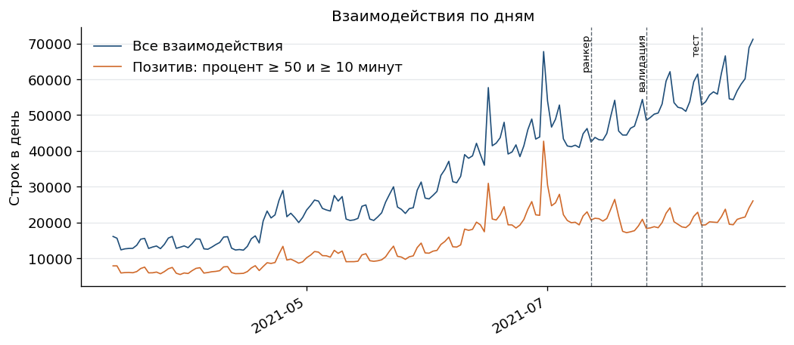

Неполный март — 264 тысячи строк, июль — 1.47 миллиона, август за 22 дня — 1.27 миллиона. По выходным больше. 22 августа — воскресенье, 71 тысяча строк при медиане около 30 тысяч по остальным дням. Это пик в конце растущего ряда. Строки из-за этого не перемешиваем, сплит только по дате.

`total_dur` лежит в секундах. У «Гнева человеческого» (132 865 строк) медиана восстановленной полной длины — 119 минут, как у фильма. У «Хрустального» высокий процент соответствует примерно 700 минутам: для сериала процент считается от всего тайтла. 17 строк длиннее 1000 часов, максимум 22 337 часов. В признак пойдет `log1p(total_dur)`, эти строки оставляем.

## Позитив

Нужен просмотр, который не бросили сразу. В строке есть процент и суммарная длительность, начала сессии нет.

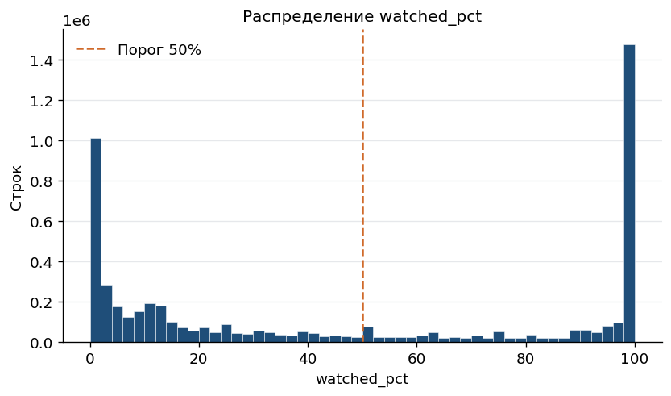

Точный ноль — 13.3% строк, точные сто — 25.7%. Еще (0, 10] — 20.7%, [50, 80) — 8.8%, [80, 100) — 9.6%. 50% стоит между коротким заходом и заметной долей тайтла.

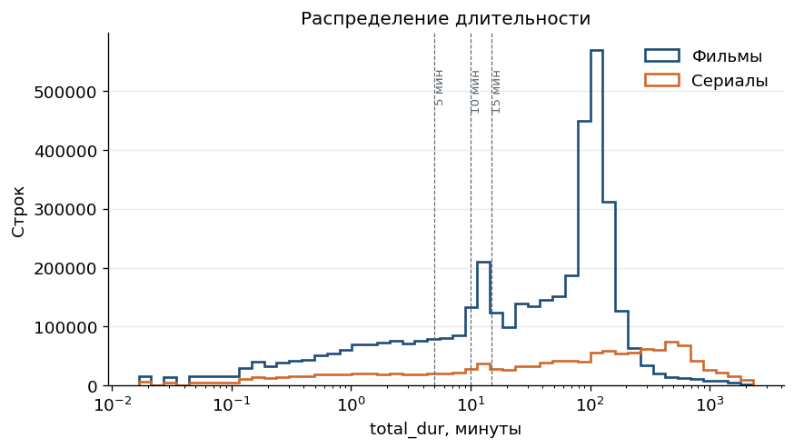

У фильмов горб около 100 минут, у сериалов хвост тянется за 10 часов. Слева от линий 5, 10 и 15 минут — короткие старты.

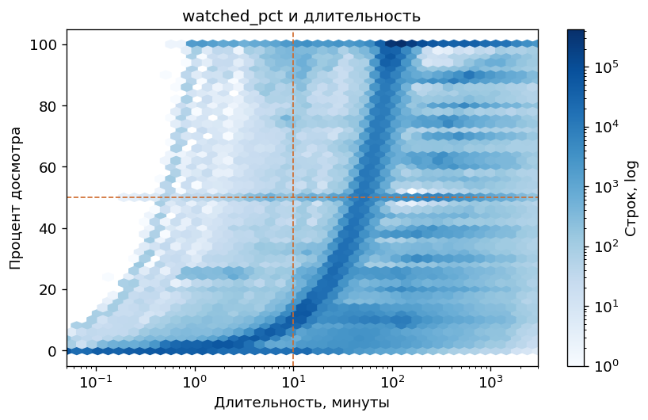

Ось длительности обрезана на 3000 минутах, иначе несколько выбросов сжимают остальное. Короткие старты лежат у нулевого процента. Строк с процентом от 50 и длительностью короче 10 минут мало.

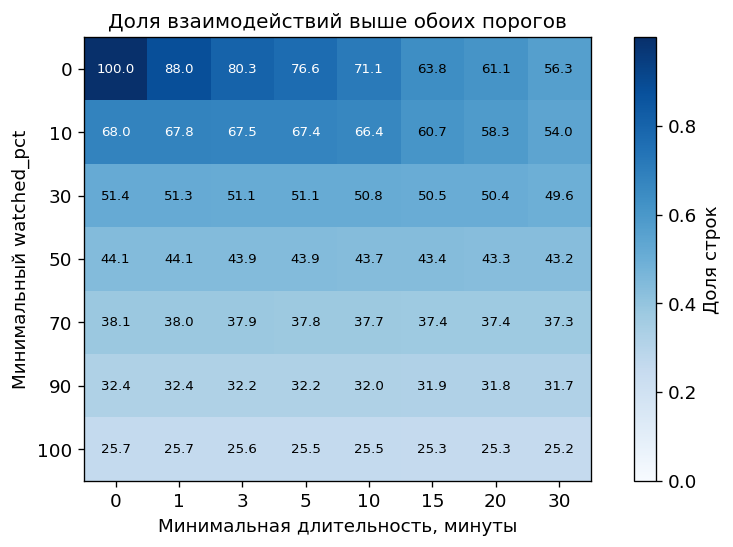

При проценте от 50 минуты почти ничего не меняют: 44.1% всех строк без порога минут и 43.7% при десяти. Десять минут убирают 25 899 строк, 1.1% от строк с процентом от 50. У строк с процентом от 50 десятый перцентиль длительности — 66 минут, медиана — 116. У фильмов медиана 108 минут, у сериалов 469.

| Правило | Доля всех строк | Доля позитивов среди фильмов | Доля позитивов среди сериалов | NDCG@10 популярности на тесте |
| --- | ---: | ---: | ---: | ---: |
| 50%, без порога минут | 44.1% | 48.5% | 30.8% | 0.136 |
| 50% и 5 минут | 43.9% | 48.1% | 30.7% | 0.137 |
| 50% и 10 минут | 43.7% | 47.9% | 30.6% | 0.137 |
| 50% и 15 минут | 43.4% | 47.6% | 30.5% | 0.138 |
| 30% и 10 минут | 50.8% | 55.2% | 37.4% | 0.131 |
| 80% и 10 минут | 35.0% | 40.2% | 18.8% | 0.118 |

Дальше позитив — `watched_pct` от 50 и `total_dur` от 10 минут, таких строк 2 390 501. На тесте NDCG@10 популярности при пороге 0–15 минут меняется с 0.136 до 0.138. При 80% и 10 минутах сериалы проседают сильнее. На валидации эти две границы не двигаем.

Сериалы при этом пороге — 24.5% взаимодействий и 17.1% позитивов. Отдельное правило для них собрать не из чего: границ серий в файле нет. Долю сериалов среди позитивов пишем рядом с метрикой.

Точный ноль в позитив не входит. Для фильтра «уже смотрел» такая пара в журнале уже есть.

## Кто смотрит и что в каталоге

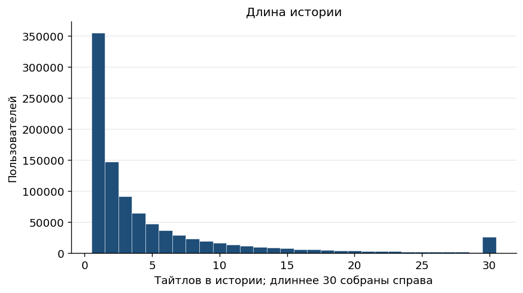

Среднее 5.69 совпадает со статьей, середину оно описывает плохо: медиана 2. Одна строка у 36.9% пользователей, две или три у 24.9%, больше десяти у 13.4%, максимум 1 341. На типичной истории трансформер видит несколько шагов.

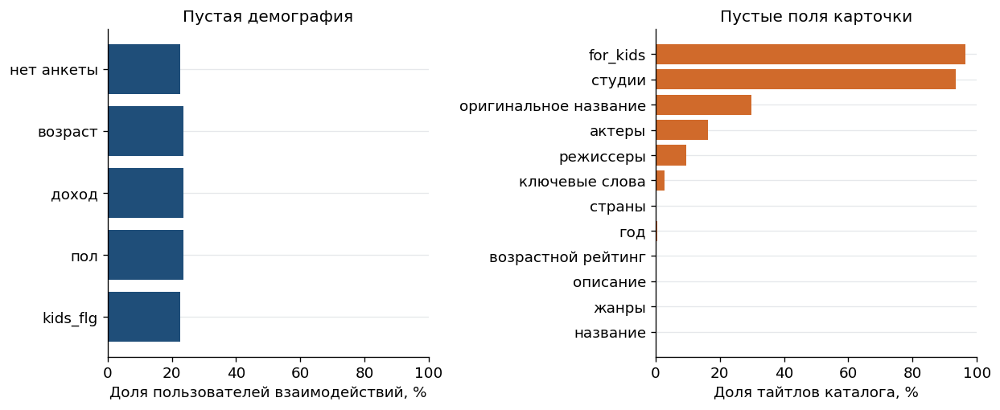

Слева доля среди пользователей журнала. «Нет анкеты» и пустой возраст почти совпадают: внутри `users.csv` возраст, пол и доход пусты примерно у 1.7% строк, `kids_flg` пустым не бывает. Без строки анкеты 22.6% журнала.

Групп «возраст × есть дети» двенадцать, все крупные: минимум 4 110 пользователей журнала, медиана около 58 тысяч. Десятка внутри группы набирается. Вместе с полом и доходом групп 143, минимум — один пользователь, и 0.9% людей с полной анкетой сидят в группах меньше 500. Пол и доход в демографический топ не кладем. В токене пользователя они остаются, с состоянием «пусто».

Справа карточка. Описание, название, жанры, страны, год и возрастной рейтинг заполнены. Оригинальное название пусто у 29.7%, актеры у 16.4%, режиссеры у 9.5%. Студии пусты у 93.3%, `for_kids` у 96.5%, единица стоит на 114 карточках. Текст для энкодера собрать можно. Студию и `for_kids` оставляем флагом пропуска.

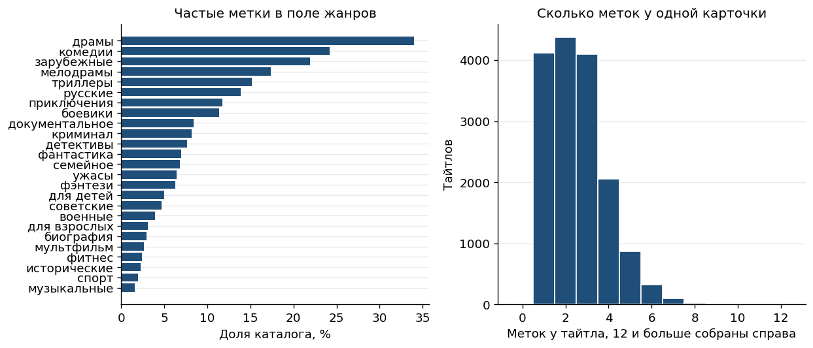

На карточку обычно две метки, максимум девять. «Драмы» стоят на 34% каталога, «комедии» на 24%. В том же поле лежат «зарубежные» (21.9%), «русские» (13.9%) и «советские» (4.7%). Для потолка «не больше пяти позиций одного жанра» это не жанр: иначе ограничение сработает на «зарубежных».

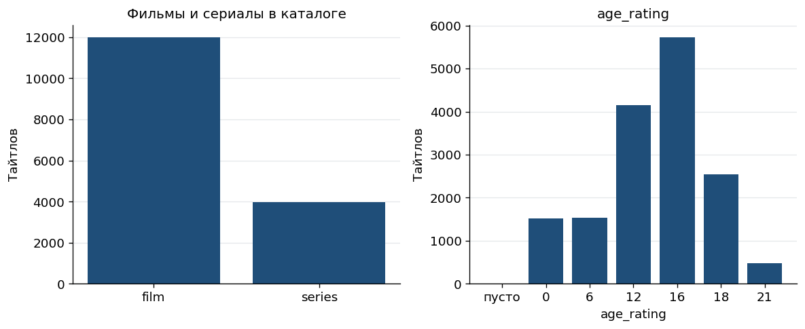

Фильмов в каталоге 12 002, сериалов 3 961. Во взаимодействиях фильмы — 75.5% строк. `age_rating` пуст у двух карточек. Значения: 0, 6, 12, 16, 18 и 21. Значение 21 стоит на 482 карточках. Потолок 18 в запросе такой тайтл не пропускает.

## Окна по 14 дней

Позитивов за последние 14, 28 и 42 дня — 297, 579 и 865 тысяч. Окна оставляем по две недели.

| Окно | Даты | Позитивов | Пользователей с позитивом до окна и в окне |
| --- | --- | ---: | ---: |
| Ранкер | 12–25 июля 2021 | 286 125 | 70 060 |
| Валидация | 26 июля – 8 августа | 282 020 | 68 312 |
| Тест | 9–22 августа | 296 904 | 73 271 |

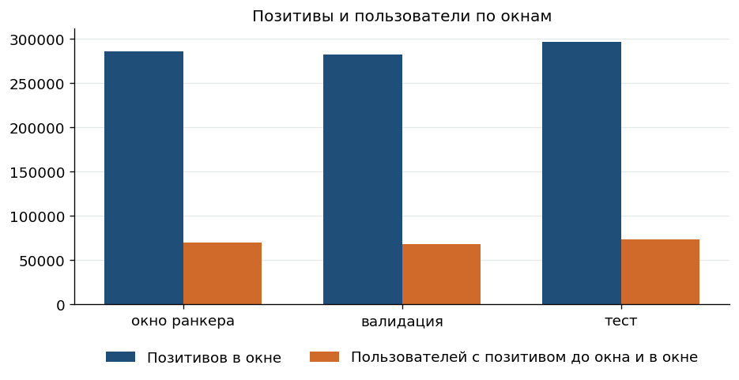

При подборе параметров башни учатся на датах до 12 июля. Перед тестом окно ранкера сдвигается на 26 июля–8 августа, башни видят даты строго раньше 26 июля.

На отсечке 9 августа позитив внутри окна есть у 132 265 пользователей.

- 73 271 (55.4%) имеют позитив и раньше. По ним считаем NDCG и Recall. Медиана прежних позитивов — 4, ровно один у 20.4%.
- 46 538 (35.2%) не имеют ни одной строки до отсечки. На них приходится 29.4% позитивных строк окна. Они идут в фолбэк и в среднее ранкера не входят.
- 12 456 (9.4%) имеют прошлые строки, но ни один прошлый просмотр не дотянул до позитива. Башню по такой истории не вызываем, список для них тот же, что при пустой истории.

Холодные тайтлы — 2.9% позитивных строк теста: до отсечки у них не было ни одного позитива. В индекс они попадают текстом карточки.

Четырнадцати дней на ранкер и на оценку хватает. Холодных пользователей в хвосте заметно больше, чем холодных тайтлов.

## Популярность на тестовом окне

Ниже числа при уже выбранном позитиве. Веса модели по ним не выбираем. Плюс 10% каждый раз считается от популярности на той отсечке, где идет оценка.

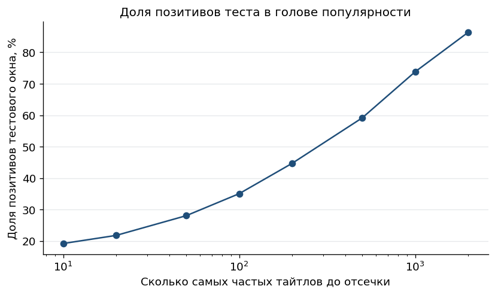

В десяти самых частых тайтлах до отсечки лежит 19.2% позитивов теста, в ста — 35.1%, в тысяче — 73.8%.

| Контур на тесте | Пользователей | NDCG@10 | Recall@10 | MAP@10 | Доля с хотя бы одним попаданием | Тайтлов в объединении десяток |
| --- | ---: | ---: | ---: | ---: | ---: | ---: |
| Глобальная популярность | 73 271 | 0.137 | 0.191 | 0.104 | 28.4% | 31 |
| Демографический топ | 73 271 | 0.136 | 0.191 | 0.101 | 28.5% | 46 |

У 27.5% пользователей глобальный топ после фильтра «уже смотрел» остается первыми десятью. У остальных список сдвигается, в объединении все равно 31 тайтл из 15 963. Демографический топ собирает 46. На валидации общий топ дает NDCG@10 0.162, демографический — 0.157. В окне ранкера у общего топа 0.188. С одного окна на другое это число не переносим.

Десятка глобального топа по позитивам до 9 августа:

| Позитивов | Тип | Возраст | Название | Жанры |
| ---: | --- | ---: | --- | --- |
| 103 177 | сериал | 18 | Клиника счастья | драмы, мелодрамы |
| 86 144 | сериал | 18 | Хрустальный | триллеры, детективы |
| 74 015 | фильм | 12 | Девятаев | драмы, военные, приключения |
| 63 776 | фильм | 18 | Гнев человеческий | боевики, триллеры |
| 47 186 | фильм | 16 | Прабабушка легкого поведения | комедии |
| 31 666 | сериал | 18 | Секреты семейной жизни | комедии |
| 24 876 | фильм | 16 | Маша | драмы, триллеры |
| 20 685 | фильм | 6 | Белый снег | драмы, спорт |
| 18 952 | фильм | 16 | Дуров | документальное |
| 15 835 | фильм | 16 | День города | комедии |

«Драмы» в этой десятке четыре раза. Потолок в пять позиций ее не меняет. Меток происхождения в ней нет.

Медиана числа позитивов по каталогу, вместе с нулями, равна 3. У 24.2% карточек до отсечки позитивов нет. Среди тайтлов хотя бы с одним медиана 7, 90-й перцентиль 297. NDCG@10 популярности на позитивах вне топ-100 равен нулю: в среднее попадают 56 263 пользователя, попаданий нет. У демографического топа там тоже около нуля. Попаданий у популярности там нет, поэтому на приемке хвост сравниваем с lift.

Справочный MAP@10, где релевантен любой просмотр, а популярность считается по всем взаимодействиям до отсечки: 0.082 на последних 14 днях (154 391 пользователь) и 0.077 на последних 7. У конкурса на закрытой неделе было около 0.091. Формула — среднее по пользователям от `AP@10`, делитель `min(10, число релевантных)`. Порядок близкий, цифру песочницы это не повторяет.

Глобальная популярность на выбранном позитиве дает NDCG@10 0.137 и Recall@10 0.191. Десять процентов сверху на этом хвосте — около 0.151. Демографический топ общий не обгоняет, оставляем его фолбэком. Coverage@10 у обоих счетчиков меньше 50 тайтлов. Старый порог «не хуже половины покрытия глобального топа» при 31 тайтле слишком слабый: половина — это 16. Нижняя граница — 320 тайтлов, 2% каталога.

## Соседи по lift

Матрица собрана по позитивам до 9 августа. Если у пользователя больше 40 позитивов, в пары идут 40 последних. Таких 2 963 из 518 863, у кого есть хотя бы один позитив до отсечки.

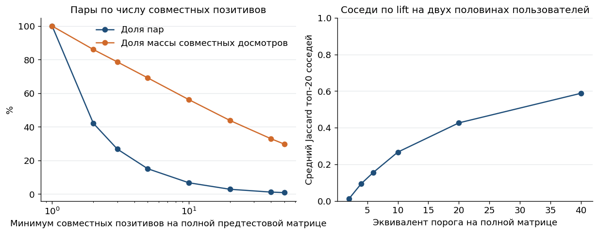

Пар 2 631 481. У 57.9% ровно один совместный позитив, медиана пары — 1, 90-й перцентиль — 7, максимум — 26 416. Порог 10 оставляет 6.7% пар и 56% массы совместных досмотров. Порог 5 оставляет 15% пар и 69% массы, порог 20 — 2.8% пар и 44% массы.

Справа средний Jaccard топ-20 соседей на двух половинах пользователей. Порог на оси приведен к полной матрице: на половине пользователей совместных досмотров примерно вдвое меньше. При эквиваленте 2 Jaccard равен 0.01, при 10 — 0.27, при 20 — 0.43, при 40 — 0.59. Из 800 проверенных тайтлов хотя бы пять соседей остаются у 763 при пороге 10, у 555 при 20 и у 339 при 40.

Одного совместного позитива для топа соседей мало. Стартовый порог — 10 на полной матрице до теста. На валидации выбираем одно из 5, 10 и 20: Jaccard с порогом еще растет. Квота соседей с каждого просмотра стартует с 20 и тоже выбирается на валидации. На тесте оба числа уже не двигаем.

## Что меняется в постановке

- Период файла — 13 марта–22 августа 2021. Хеш архива записан в дизайн-документе.
- Позитив — процент от 50 и длительность от 10 минут.
- Окна по 14 дней. Тест: 9–22 августа 2021.
- В среднее метрики входят пользователи с позитивом до окна и внутри окна. На тесте это 55.4% тех, у кого позитив в окне есть.
- Демографический ключ — возраст и `kids_flg`. Пол и доход в него не входят.
- Студии и `for_kids` идут в вектор тайтла только как пропуск. Метки происхождения не участвуют в потолке жанра и в жанровом признаке.
- Порог совместных позитивов для lift стартует с 10. Валидация выбирает из 5, 10 и 20.
- Coverage@10 не ниже 320 тайтлов. Хвост — позитивы вне топ-100, сравнение с lift.
- Плюс 10% NDCG@10 считается от глобальной популярности на той же отсечке. Демографический топ пишем в отчет, отдельного порога по нему нет.
